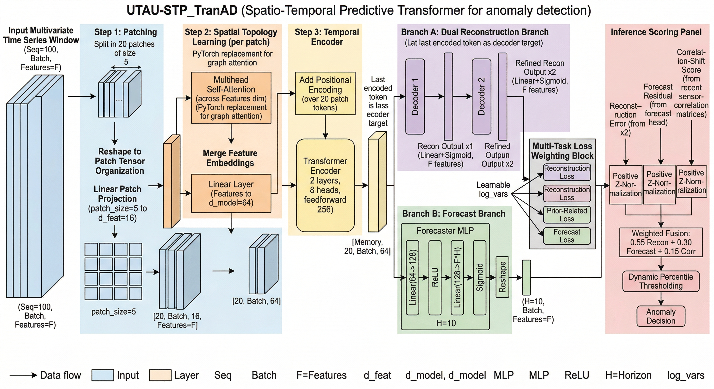
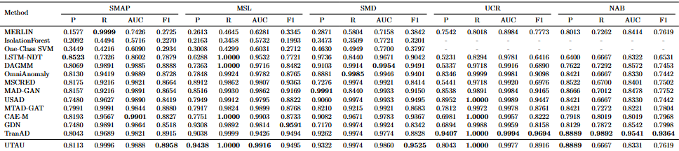
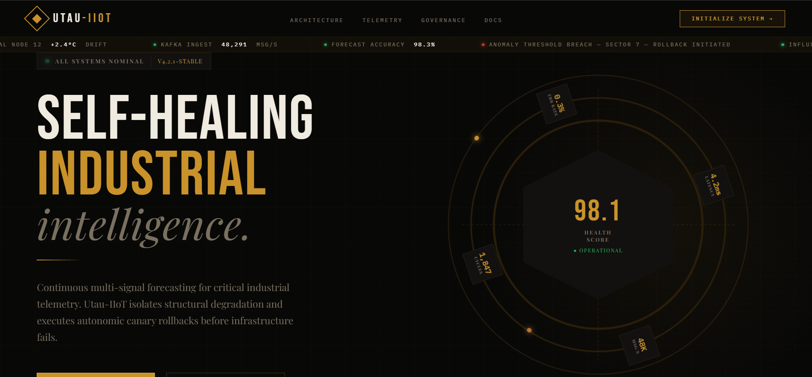
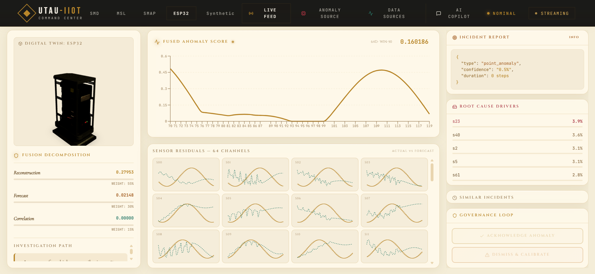
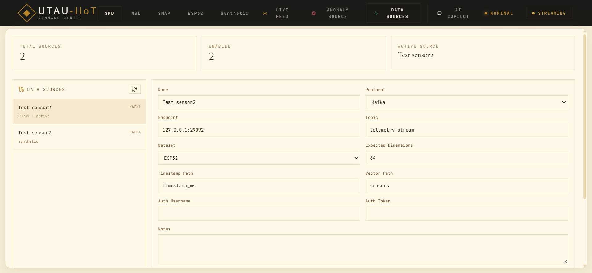
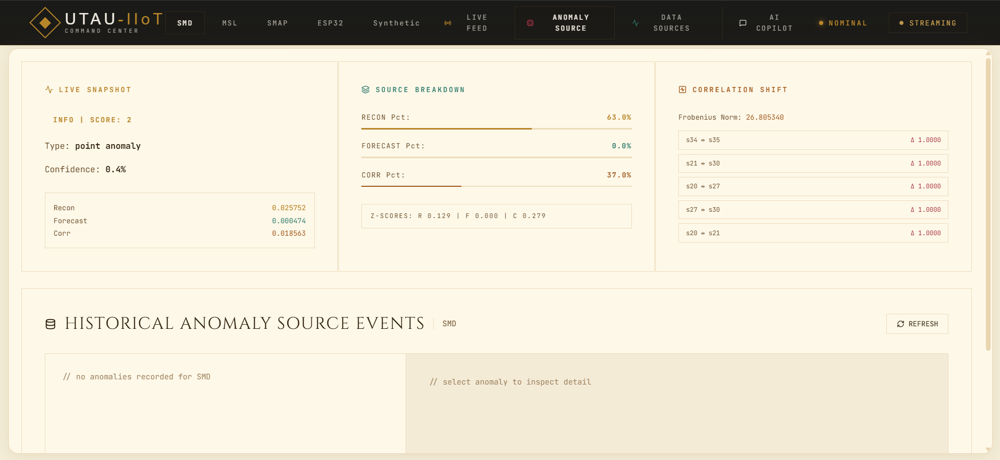
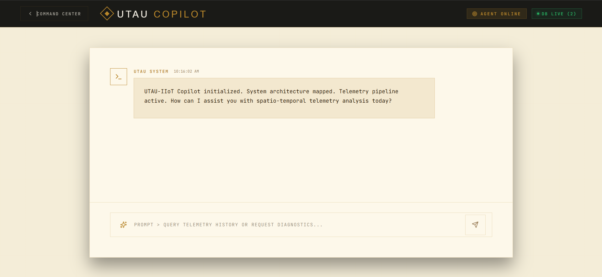
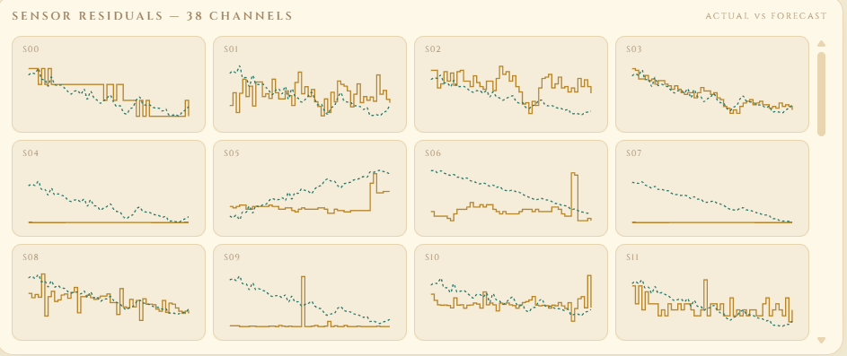

# UTAU: Streaming Anomaly Detection SOTA Novel Platform (Custom NN STP_TranAD + Dashboard + ESP32)

A custom Neural network architecture based solution for anomaly detectiot, outperforming SOTA baseline architectures like TranAD, GDN, etc. :

## Architecture Diagram



## Benchmark Scores



## Mock images

<table>
  <tr>
    <td></td>
    <td></td>
  </tr>
  <tr>
    <td></td>
    <td></td>
  </tr>
  <tr>
    <td></td>
    <td></td>
  </tr>
</table>

- A FastAPI backend for live ingest, scoring, governance, and model hot-swap.
- A React dashboard for live monitoring, investigation, and source management.
- Kafka-based streaming ingestion.
- Optional InfluxDB persistence.
- ESP32 telemetry integration through MQTT to Kafka bridging.
- Synthetic dataset tooling for reproducible end-to-end testing.

This README is the consolidated operational guide for the current project state.

It covers both the latest ESP32 and source-management additions and the earlier foundational phases (Phase 1 through Phase 9) that introduced ingest hardening, fused scoring, explainability, governance, Influx persistence, RL suggestion loops, and guarded policy apply/rollback.

---

## 1) Repository Layout

- `Frontend/`
  - React + Vite dashboard UI.
- `TranAD-main/`
  - FastAPI backend, model runtime, streaming consumers/producers, bridge scripts, and training/testing pipeline.
- `docker-compose.yml`
  - Local infrastructure services (Kafka, optional InfluxDB).

Important runtime files:

- `TranAD-main/server.py`
  - Main backend server and runtime state machine.
- `TranAD-main/kafka_producer.py`
  - Simulator producer to feed Kafka.
- `TranAD-main/esp32_mqtt_kafka_bridge.py`
  - MQTT subscriber + payload normalizer + Kafka publisher.
- `TranAD-main/export_esp32_replay.py`
  - Root launcher for ESP32 replay asset export.
- `TranAD-main/scripts/export_esp32_replay.py`
  - Generates ESP32 replay CSV/header/meta from synthetic arrays.
- `TranAD-main/esp32/TranAD_ESP32_Replay/TranAD_ESP32_Replay.ino`
  - ESP32 sketch for replay publishing.

---

## 2) What Has Been Implemented

### 2.1 Dashboard and UX

- Added a Data Sources tab in the frontend.
- Added an ESP32 dataset tab in the dataset selector.
- Added/maintained anomaly investigation UI flows.
- Improved websocket lifecycle behavior across dataset switching.

### 2.2 Backend Runtime and APIs

- Source registry with persistence and source management APIs.
- Dataset hot-swap endpoint with guardrails and rollback-safe behavior.
- Runtime status endpoint with detailed ingest, scoring, Kafka, Influx, and feature flags.
- Anomaly listing and detail APIs.
- Policy and governance scaffolding (suggestions/events/feedback integration).

### 2.3 Streaming and Reliability

- Kafka consumer support enabled for live ingest.
- Producer status polling hardened against timeout/network errors.
- Better observability on ingest counters and drop reasons.

### 2.4 ESP32 End-to-End Pipeline

- `ESP32` dataset mode in backend (model/data alias to synthetic artifacts).
- MQTT -> Kafka bridge with payload normalization and live counters.
- ESP32 replay header export tooling.
- ESP32 sketch that publishes expected JSON schema.
- Runtime hardening:
  - Safer ESP32 memory/buffer handling.
  - MQTT broker failover support in sketch and bridge.
  - Better diagnostics for no-message scenarios.

### 2.5 Data and Validation Tooling

- Synthetic pipeline dataset generation for system-level testing.
- Optional InfluxDB write path and status reporting.
- Backfill tooling for historical governance/feedback traces.

### 2.6 Historical Phase Coverage (Phase 1 to Phase 9)

- Phase 1: Ingestion reliability
  - Timestamp ordering/skew checks, dimension guards, imputation fallback, outlier and degraded-mode accounting.
- Phase 2: Fused scoring
  - Reconstruction + forecast + correlation-shift component scoring, normalization, weighted fusion, dynamic thresholding.
- Phase 3: Explainability and investigation
  - Severity/confidence/anomaly-type shaping, contributors, similar-history hints, anomaly investigation APIs, frontend anomaly source tab.
- Phase 4: Adaptive governance loop
  - Operator feedback persistence, drift monitoring, retrain recommendation flow, guarded calibration with rollback protections.
- Phase 5: InfluxDB runtime persistence
  - Async queue writer, measurement emission, health/status visibility, dead-letter fallback.
- Phase 6: Policy event alignment
  - Recommendation, calibration, and retrain lifecycle events persisted into policy-oriented telemetry stream.
- Phase 7: Historical backfill
  - Backfill utility for SQLite feedback and checkpoint metadata into Influx measurements.
- Phase 8: RL suggestion-only policy loop
  - Suggest, reward, and stats APIs with persistent RL state and no automatic policy mutation.
- Phase 9: Guarded manual apply and rollback
  - Dry-run/canary/force apply modes, bounded guardrails, canary alert-rate checks, rollback, and policy history audit.

---

## 3) Prerequisites

- Windows (commands below are PowerShell-first).
- Conda environment with required Python dependencies.
- Node.js for frontend.
- Docker Desktop for Kafka/Influx/Mosquitto containers.

Recommended Python environment activation:

```powershell
conda activate tranad
```

Install backend dependencies:

```powershell
Set-Location TranAD-main
pip install -r requirements.txt
```

Install frontend dependencies:

```powershell
Set-Location ..\Frontend
npm install
```

---

## 4) Quick Start (Local Full Stack)

From repository root:

### 4.1 Start Infrastructure

```powershell
docker compose up -d kafka
```

Optional InfluxDB:

```powershell
docker compose up -d influxdb
```

Optional local MQTT broker for ESP32 path:

```powershell
docker run -d --name catch-mosquitto -p 1883:1883 eclipse-mosquitto:2
```

### 4.2 Start Backend

```powershell
Set-Location TranAD-main
conda activate tranad
$env:KAFKA_CONSUMER_ENABLED="true"
$env:KAFKA_BOOTSTRAP_SERVERS="127.0.0.1:29092"
$env:KAFKA_TOPIC="telemetry-stream"
python .\server.py
```

Optional Influx-enabled backend:

```powershell
$env:INFLUX_ENABLED="true"
$env:INFLUX_URL="http://127.0.0.1:8086"
$env:INFLUX_TOKEN="catch-dev-token"
$env:INFLUX_ORG="catch-org"
$env:INFLUX_BUCKET="catch-telemetry"
python .\server.py
```

### 4.3 Start Frontend

```powershell
Set-Location ..\Frontend
npm run dev
```

### 4.4 Start Kafka Simulator (Optional)

```powershell
Set-Location ..\TranAD-main
conda activate tranad
python .\kafka_producer.py --dataset synthetic --topic telemetry-stream --hz 2 --loop
```

---

## 5) Core Operational APIs

Base URL: `http://127.0.0.1:8000`

Core streaming endpoints:

- `POST /ingest`
- `WS /ws/stream`
- `GET /status`
- `POST /change_dataset`
- `POST /calibrate`

- `GET /sources`
  - List configured source profiles.
- `POST /sources`
  - Create source profile.
- `PATCH /sources/{source_id}`
  - Update source profile and active behavior.
- `GET /sources/{source_id}/health`
  - Source health and ingest quality snapshot.
- `POST /sources/{source_id}/mapping/validate`
  - Validate timestamp/vector path mapping against sample payload.
- `GET /anomalies`
- `GET /anomalies/{anomaly_id}`

Governance endpoints:

- `POST /feedback`
- `GET /feedback/summary`
- `GET /retrain/plan`
- `POST /retrain/mark_applied`

RL and policy-control endpoints (feature-gated):

- `GET /policy/suggest`
- `POST /policy/reward`
- `GET /policy/stats`
- `POST /policy/apply`
- `POST /policy/rollback`
- `GET /policy/history`

Example dataset switch:

```powershell
$body = @{ dataset = 'ESP32' } | ConvertTo-Json
Invoke-RestMethod -Uri "http://127.0.0.1:8000/change_dataset" -Method Post -ContentType "application/json" -Body $body
```

Optional HTTP simulator ingest path (instead of Kafka producer):

```powershell
Set-Location TranAD-main
conda activate tranad
python .\kafka_simulator.py
```

---

## 6) ESP32 Integration Runbook

### 6.1 Configure Backend Runtime for ESP32

Set active runtime dataset to ESP32:

```powershell
$body = @{ dataset = 'ESP32' } | ConvertTo-Json
Invoke-RestMethod -Uri "http://127.0.0.1:8000/change_dataset" -Method Post -ContentType "application/json" -Body $body
```

Ensure active source profile matches 64-dim ESP32 payloads:

```powershell
$patch = @{
  dataset = 'ESP32'
  expected_dimensions = 64
  protocol = 'kafka'
  endpoint = '127.0.0.1:29092'
  topic = 'telemetry-stream'
} | ConvertTo-Json
Invoke-RestMethod -Uri "http://127.0.0.1:8000/sources/1" -Method Patch -ContentType "application/json" -Body $patch
```

### 6.2 Export Replay Assets for Firmware

```powershell
Set-Location TranAD-main
conda activate tranad
python .\export_esp32_replay.py --frames 512 --channels 64 --step-ms 500
```

Artifacts written under `TranAD-main/data/synthetic/`:

- `esp32_replay.csv`
- `esp32_replay.h`
- `esp32_replay_meta.json`

Copy `esp32_replay.h` into:

- `TranAD-main/esp32/TranAD_ESP32_Replay/`

### 6.3 Flash ESP32 Sketch

Sketch file:

- `TranAD-main/esp32/TranAD_ESP32_Replay/TranAD_ESP32_Replay.ino`

Set Wi-Fi and MQTT values in sketch config before uploading.

### 6.4 Run MQTT -> Kafka Bridge

```powershell
Set-Location TranAD-main
conda activate tranad
python .\esp32_mqtt_kafka_bridge.py --mqtt-host 127.0.0.1 --mqtt-hosts 127.0.0.1,broker.hivemq.com --mqtt-port 1883 --mqtt-topic esp32/telemetry --kafka-bootstrap-servers 127.0.0.1:29092 --kafka-topic telemetry-stream --dataset ESP32 --expected-dimensions 64
```

Bridge behavior includes:

- Live counters (`mqtt`, `parse_errors`, `invalid`, `kafka_published`).
- Diagnostic hints when connected but no MQTT messages are received.
- Optional host failover if no traffic is observed for configured duration.

### 6.5 Expected Telemetry Schema

```json
{
  "timestamp_ms": 1710000000000,
  "source_id": "esp32-001",
  "seq_id": 1,
  "sensors": [0.1, 0.2, 0.3]
}
```

---

## 7) Synthetic Data and Model Workflows

### 7.1 Generate Synthetic Pipeline Dataset

```powershell
Set-Location TranAD-main
conda activate tranad
python .\generate_synthetic_pipeline_dataset.py --signals 64 --train-steps 12000 --test-steps 6000 --seed 77 --write-checkpoint
```

### 7.2 Train/Test via Main Entry

```powershell
Set-Location TranAD-main
conda activate tranad
python .\main.py --model TranAD --dataset SMD --retrain
```

Supported datasets include: `SMD`, `MSL`, `SMAP`, `synthetic` (and project-specific runtime alias `ESP32` for serving).

---

## 8) Troubleshooting Guide

### 8.1 Dashboard Shows No Waves/Data

Check in order:

1. `GET /status` and verify:
   - `active_dataset` matches current stream.
   - `ingest.totals.accepted` is increasing.
   - `kafka.connected` is true.
2. If Kafka `received_count` rises but `accepted` does not:
   - You likely have a dimension mismatch.
   - Align runtime dataset and source expected dimensions.
3. Frontend must be on the intended dataset tab (for ESP32, select ESP32).

### 8.2 ESP32 Connected but Bridge Shows `mqtt=0`

- Confirm sketch broker host/port and topic exactly match bridge subscription.
- Confirm local MQTT broker is reachable from device network.
- On Windows, allow inbound TCP 1883 on private network if using local broker.
- Use bridge failover hosts or public broker fallback for quick isolation.

### 8.3 Frequent Dimension Mismatch Drops

- Check `GET /status`:
  - `dimensions` is model expectation.
- Check `GET /sources` active source:
  - `expected_dimensions` should match payload length.
- For ESP32 flow, use 64 dimensions consistently.

### 8.4 Backend Startup with Kafka But No Ingest

Ensure env vars are set in same shell where server is launched:

- `KAFKA_CONSUMER_ENABLED=true`
- `KAFKA_BOOTSTRAP_SERVERS=127.0.0.1:29092`
- `KAFKA_TOPIC=telemetry-stream`

---

## 9) Feature Flags and Governance Notes

Feature flags exposed via backend status and frontend build/runtime include:

- Anomaly source tab enablement.
- RL policy suggestion enablement.

Governance-oriented runtime includes:

- Policy suggestion scaffolding.
- Feedback summary support.
- Drift/retraining recommendation state tracking.

Policy safety model:

- RL suggestions do not auto-apply runtime threshold changes.
- Apply requires explicit operator action through policy apply APIs.
- Guardrails constrain policy deltas.
- Canary validation checks alert-rate shift before committing policy.
- Rollback restores previous policy snapshot and records audit history.

---

## 10) Known Operational Caveats

- Dataset mismatch is the most common reason for zero graphs even when streams are active.
- ESP32 + local broker often fails due to LAN/firewall constraints, not model/runtime code.
- IDE diagnostics for Arduino includes are expected unless Arduino toolchain include paths are configured in that IDE context.

---

## 11) Recommended Daily Ops Checklist

1. Start Kafka (and optional Influx/MQTT).
2. Start backend with Kafka env vars.
3. Confirm `GET /status` healthy baseline.
4. Select and confirm active dataset.
5. Ensure source profile expected dimensions match payload.
6. Start producer/bridge/device.
7. Watch `accepted` and `source health` while monitoring dashboard.

---

## 12) License and Attribution

Base TranAD implementation and paper attribution remain in `TranAD-main/`.
Please keep original licensing and citations from upstream TranAD where applicable.

---

## 13) Runtime Topology and Lifecycle (Historical + Current)

Infrastructure layer:

- Kafka broker for stream transport.
- InfluxDB for optional observability persistence.
- Optional MQTT broker for ESP32 ingress path.

Application layer:

- Backend service in `TranAD-main/server.py`.
- Frontend dashboard in `Frontend/`.
- Producers via HTTP simulator, Kafka producer, or ESP32 through MQTT bridge.

Lifecycle summary:

1. Start infrastructure services.
2. Backend startup initializes feedback DB, model runtime, ingestion state, governance loop, and optional Kafka/Influx/RL tasks.
3. Data arrives through HTTP ingest or Kafka consumer, then converges into the same ingestion sanitizer pipeline.
4. Websocket inference loop computes fused score and anomaly payloads for dashboard rendering.
5. Operator feedback/governance actions update state and optionally emit persistent policy/feedback events.

---

## 14) Configuration Groups

Key environment variable groups used across phases:

- Ingest reliability: INGEST_* variables
- Fused scoring behavior: FUSED_* variables
- Governance and retraining: DRIFT_*, RETRAIN_*, CALIBRATE_*
- Kafka integration: KAFKA_*
- Influx integration: INFLUX_*
- Feature flags: FEATURE_ANOMALY_SOURCE_TAB, FEATURE_RL_POLICY_SUGGESTIONS
- RL tuning: RL_POLICY_*
- Guarded apply and canary controls: POLICY_APPLY_*, POLICY_CANARY_*

---

## 15) Verification Checklist

Use this checklist to validate the full implementation envelope:

1. Live stream updates appear over websocket and dashboard charts move.
2. Dataset switch works without shape crashes and status dimensions align with payload dimensions.
3. Feedback actions persist and status counters reflect events.
4. Retrain recommendation and mark-applied lifecycle behave as expected.
5. Influx measurements increase for anomaly, ingest quality, feedback, drift, and policy events (when enabled).
6. Backfill script runs successfully and verification counts are consistent.
7. RL flow works in sequence: suggest -> reward -> stats.
8. Policy apply flow works: dry-run validation, canary or force apply, rollback, and history visibility.

---

## 16) Major Cross-Phase Files

- `TranAD-main/server.py`
- `TranAD-main/src/rl_policy_manager.py`
- `TranAD-main/scripts/backfill_influxdb.py`
- `TranAD-main/kafka_simulator.py`
- `TranAD-main/kafka_producer.py`
- `TranAD-main/esp32_mqtt_kafka_bridge.py`
- `TranAD-main/esp32/TranAD_ESP32_Replay/TranAD_ESP32_Replay.ino`
- `TranAD-main/README.md`
- `docker-compose.yml`
- `Frontend/src/App.tsx`
- `Frontend/src/components/AnomalySourceTab.tsx`
